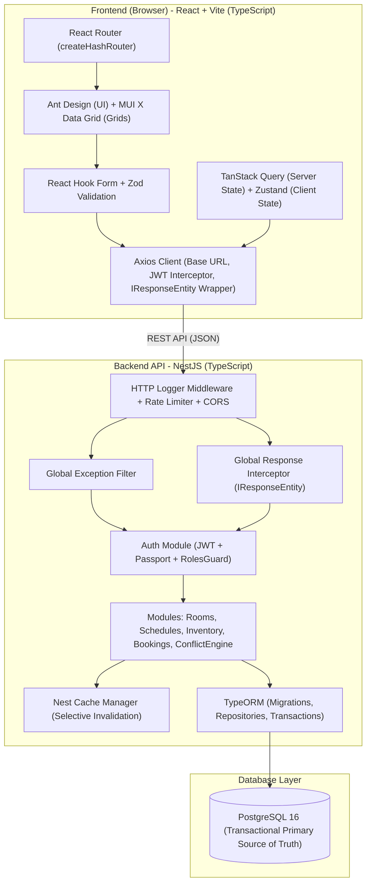

# PHASE 0 AUDIT REPORT: DESKTOP & DATA AUDIT
**Proyek:** Campus Facility & Schedule Manager (FasiLink)  
**Status:** Selesai (Phase 0 Audit Complete)  
**Tanggal Audit:** 4 November 2026  
**Auditor:** Antigravity (AI Assistant)  
**Target:** Migrasi Desktop (JavaFX + SQLite) ke Web (React + NestJS + PostgreSQL) berdasarkan standar LSKK & SOP Pustekhan ITB

---

## 1. Status File Acuan & Environment

1. **`IMPLEMENTATION_PLAN_WEB.md`**:  
   - **Status:** Ditemukan dan dipelajari (`fasilink-web/docs/IMPLEMENTATION_PLAN_WEB.md`).  
   - Menjadi acuan utama seluruh pembagian fase, SOP gate, dan arsitektur target.
2. **Standar Engineering LSKK & Pustekhan**:  
   - **Status:** Ditemukan di `fasilink-web/docs/standards/`:
     - `Frontend_Web_Development_Standard_Stack_LSKK_v1_0.pdf`
     - `Backend_Development_Standard_Stack_LSKK_v1_0.pdf`
     - `Standar Arsitektur Sistem LSKK v1.1.pdf` (Status dokumen: *Draft untuk Review* 8 September 2026)
     - `Standar Kerja Sistem Development & Deployment Pustekhan ITB-2.pdf`
3. **Rule dari `ANTIGRAVITY_WEB_RULES.zip`**:  
   - **Status:** Telah diekstrak dan dipelajari di `fasilink-web/docs/ANTIGRAVITY_WEB_RULES/ANTIGRAVITY_WEB_RULES/.agents/rules/` (`architecture-migration.md`, `backend.md`, `data-business.md`, `frontend.md`, `testing-release.md`).
4. **Pemeriksaan `AGENTS.md`**:  
   - **Status:** Ditemukan di dalam folder hasil ekstraksi zip: `fasilink-web/docs/ANTIGRAVITY_WEB_RULES/ANTIGRAVITY_WEB_RULES/AGENTS.md`.  
   - *Catatan Kepatuhan:* File tidak berada langsung di root workspace `fasilink-web/AGENTS.md`, melainkan di dalam paket rules yang diekstrak. Seluruh instruksi workspace di dalamnya telah dibaca dan diterapkan dalam audit ini.

---

## 2. Repository Map (Aplikasi Desktop `fasilink/`)

Aplikasi desktop telah selesai dibangun menggunakan struktur Maven berlapis (*Layered Architecture*) dengan JavaFX FXML. Seluruh kode sumber berada di `fasilink/` tanpa modifikasi sedikit pun selama audit.

```text
fasilink/
├── pom.xml                                   # Konfigurasi Maven (Java 21, JavaFX 21, SQLite JDBC, jBCrypt, JUnit 5)
├── README.md                                 # Dokumentasi sistem, credential demo, dan panduan run/test
├── BACKEND_ENGINEERING.md                    # Dokumentasi arsitektur backend desktop & kontrak service
├── FRONTEND_ENGINEERING.md                   # Dokumentasi UI JavaFX, layout FXML, dan CSS
├── IMPLEMENTATION_PLAN.md                    # Rencana kerja pengembangan desktop (Naura & Arsal)
├── PEMBAGIAN_TUGAS_NAURA_ARSAL.md            # Matriks kontribusi pengembang desktop
├── src/
│   ├── main/
│   │   ├── java/id/ac/campusfacility/
│   │   │   ├── MainApp.java                  # Entry point aplikasi JavaFX
│   │   │   ├── config/
│   │   │   │   ├── AppConfig.java            # Konfigurasi path database JDBC SQLite ("data/campus_facility.db")
│   │   │   │   ├── DatabaseManager.java      # Singleton Connection Pool/Provider JDBC dengan foreign_keys = ON
│   │   │   │   └── DatabaseInitializer.java  # DDL migration & Data Seeding otomatis
│   │   │   ├── model/                        # Domain entities
│   │   │   │   ├── User.java, AcademicTerm.java, Room.java, InventoryItem.java,
│   │   │   │   ├── Course.java, ClassGroup.java, Lecturer.java, LecturerAvailability.java,
│   │   │   │   ├── Schedule.java, RoomBookingRequest.java, InventoryLoanRequest.java,
│   │   │   │   └── ScheduleChangeRequest.java
│   │   │   ├── model/enums/
│   │   │   │   ├── Role.java                 # ADMIN, USER
│   │   │   │   ├── BookingStatus.java        # PENDING, APPROVED, REJECTED, CANCELLED
│   │   │   │   ├── InventoryLoanStatus.java  # PENDING, APPROVED, REJECTED, CANCELLED, HANDED_OVER, RETURNED
│   │   │   │   ├── ScheduleChangeStatus.java # PENDING, APPROVED, REJECTED, CANCELLED
│   │   │   │   └── ConflictType.java         # ROOM, LECTURER, CLASS_GROUP, CAPACITY, LECTURER_UNAVAILABLE
│   │   │   ├── dto/
│   │   │   │   ├── AlternativeScheduleCandidate.java
│   │   │   │   ├── AlternativeScheduleQuery.java
│   │   │   │   ├── DashboardSummary.java
│   │   │   │   └── ScheduleConflict.java
│   │   │   ├── repository/                   # Lapisan persistensi JDBC dengan PreparedStatement
│   │   │   │   ├── UserRepository.java
│   │   │   │   ├── AcademicDataRepository.java
│   │   │   │   ├── RoomRepository.java
│   │   │   │   ├── InventoryRepository.java
│   │   │   │   ├── ScheduleRepository.java
│   │   │   │   ├── LecturerAvailabilityRepository.java
│   │   │   │   ├── RoomBookingRepository.java
│   │   │   │   ├── InventoryLoanRepository.java
│   │   │   │   └── ScheduleChangeRepository.java
│   │   │   ├── service/                      # Lapisan Business Logic, Conflict Engine, & Transaction Guard
│   │   │   │   ├── AuthService.java
│   │   │   │   ├── DashboardService.java
│   │   │   │   ├── RoomService.java
│   │   │   │   ├── InventoryService.java
│   │   │   │   ├── ScheduleService.java
│   │   │   │   ├── ScheduleConflictService.java
│   │   │   │   ├── RoomBookingService.java
│   │   │   │   ├── InventoryLoanService.java
│   │   │   │   └── AlternativeScheduleService.java
│   │   │   ├── session/
│   │   │   │   └── UserSession.java          # In-memory thread-safe user session & Role guard
│   │   │   ├── validation/                   # Runtime exceptions
│   │   │   │   ├── ValidationException.java
│   │   │   │   ├── AuthorizationException.java
│   │   │   │   ├── ConflictException.java
│   │   │   │   └── NotFoundException.java
│   │   │   ├── util/
│   │   │   │   ├── PasswordHasher.java       # Wrapper jBCrypt
│   │   │   │   ├── TimeRange.java            # Overlap evaluator
│   │   │   │   └── ViewNavigator.java        # Navigasi AppShell JavaFX
│   │   │   └── controller/                   # Controller JavaFX UI
│   │   │       ├── LoginController.java
│   │   │       ├── AppShellController.java
│   │   │       ├── AdminDashboardController.java
│   │   │       ├── UserDashboardController.java
│   │   │       ├── RoomManagementController.java
│   │   │       ├── CampusScheduleController.java
│   │   │       ├── InventoryManagementController.java
│   │   │       ├── RoomBookingController.java
│   │   │       ├── InventoryLoanController.java
│   │   │       ├── MyRequestsController.java
│   │   │       ├── AdminApprovalsController.java
│   │   │       └── AlternativeScheduleSearchController.java
│   │   └── resources/
│   │       ├── css/app.css                   # Custom JavaFX CSS modern UI
│   │       └── fxml/ (12 FXML layout views)
│   └── test/java/id/ac/campusfacility/       # Unit & Integration Tests (10 Test Suites, JUnit 5)
│       ├── BaseTest.java                     # Temp SQLite DB in-memory per-test lifecycle
│       ├── config/DatabaseInitializerTest.java
│       ├── service/ (8 Test Classes)
│       └── util/ (2 Test Classes)
```

---

## 3. Feature-Parity Matrix (Desktop vs Target Web)

Seluruh fitur desktop di bawah telah diverifikasi langsung dari kode sumber backend JavaFX (`*.java`) dan UI view (`*.fxml`):

| No | Fitur / Sub-fitur Desktop | Status Verifikasi Desktop | Implementasi Aktual Desktop | Rencana Implementasi Web (SOP Pustekhan) |
|---|---|---|---|---|
| **1** | **Autentikasi & Sesi** | | | |
| 1.1 | Login dengan username & password | **Verified** | `AuthService.login`, BCrypt verify | NestJS Auth (`POST /api/v1/auth/login`), JWT + Passport |
| 1.2 | In-memory session & role authorization | **Verified** | `UserSession.java`, cek `ADMIN`/`USER` | JWT Bearer token, NestJS `AuthGuard` & `RolesGuard` |
| 1.3 | Ganti Password | **Verified** | `AuthService.changePassword` (min 6 char) | `POST /api/v1/auth/change-password` |
| 1.4 | Logout | **Verified** | `UserSession.clear()` | Client token purge / Blacklist guard |
| **2** | **App Shell & Navigasi** | | | |
| 2.1 | Sidebar adaptif berbasis Role | **Verified** | `AppShellController.java` | React Router `createHashRouter` + Ant Design Layout |
| 2.2 | Profile badge & dynamic header | **Verified** | JavaFX AppShell header | Header component dengan data profil dari auth state |
| **3** | **Dashboard** | | | |
| 3.1 | Admin Dashboard KPI & Summary | **Verified** | `DashboardService.java` (ruangan aktif, jadwal, stok, pending) | `GET /api/v1/dashboard/admin` + TanStack Query |
| 3.2 | User Dashboard ketersediaan cepat | **Verified** | `UserDashboardController.java` | `GET /api/v1/dashboard/user` |
| **4** | **Manajemen Ruangan** | | | |
| 4.1 | Katalog ruangan & filter pencarian | **Verified** | `RoomService.getAllRooms`, `getActiveRooms` | `GET /api/v1/rooms` (Ant Design Table / MUI DataGrid) |
| 4.2 | Tambah & ubah ruangan | **Verified** | `createRoom`, `updateRoom` (Admin only) | `POST /api/v1/rooms`, `PUT /api/v1/rooms/:id` |
| 4.3 | Soft deactivate vs Hard delete | **Verified** | `RoomService.deleteRoom`: hard delete jika belum dipakai, soft delete (`is_active=0`) jika ada referensi FK | `DELETE /api/v1/rooms/:id` mengikuti aturan yang sama |
| 4.4 | Pengecekan ketersediaan ruangan | **Verified** | `RoomService.isRoomAvailable` | `GET /api/v1/rooms/check-availability` |
| **5** | **Jadwal Perkuliahan Kampus** | | | |
| 5.1 | Tampilan jadwal mingguan resmi | **Verified** | `CampusScheduleController`, filter hari, ruangan, matkul | `GET /api/v1/schedules` dengan filter term & hari |
| 5.2 | Tambah & ubah jadwal kuliah | **Verified** | `ScheduleService.createSchedule` + Multi-conflict check | `POST /api/v1/schedules`, `PUT /api/v1/schedules/:id` |
| 5.3 | Hapus / nonaktifkan jadwal | **Verified** | `ScheduleService.deleteSchedule` (`is_active=0`) | `DELETE /api/v1/schedules/:id` |
| **6** | **Engine Pemeriksaan Bentrok (Conflict Service)** | | | |
| 6.1 | Overlap time interval rule | **Verified** | `s1 < e2 && s2 < e1` (titik singgung diizinkan) | Ditulis ulang di NestJS `ScheduleConflictService` |
| 6.2 | Deteksi bentrok ruangan | **Verified** | `ScheduleConflictService.checkConflicts` | Pengecekan overlap pada tabel schedules |
| 6.3 | Deteksi bentrok dosen & kelas | **Verified** | Memeriksa dosen & rombel kelas di jam yang sama | Pengecekan komprehensif pada interval yang sama |
| 6.4 | Validasi kapasitas ruangan vs rombel | **Verified** | `room.capacity < classGroup.studentCount` | Validasi constraint kapasitas kelas |
| 6.5 | Validasi jendela ketersediaan dosen | **Verified** | `lecturer_availability` window check | Validasi jadwal terhadap preferensi dosen |
| **7** | **Manajemen Inventaris & Sirkulasi** | | | |
| 7.1 | Katalog barang & perhitungan stok dinamis | **Verified** | `availableStock = total - sum(APPROVED + HANDED_OVER)` | `GET /api/v1/inventory` dengan kalkulasi persis |
| 7.2 | CRUD master inventaris | **Verified** | `createItem`, `updateItem`, stok non-negatif | `POST`, `PUT`, `DELETE /api/v1/inventory` |
| 7.3 | Proteksi hapus barang terpinjam | **Verified** | Tolak hapus jika `reserved > 0` | Exception filter mengembalikan HTTP 409 Conflict |
| **8** | **Peminjaman Ruangan (`RoomBooking`)** | | | |
| 8.1 | Pengajuan peminjaman oleh User | **Verified** | `RoomBookingService.createBookingRequest`, status PENDING | `POST /api/v1/room-bookings` |
| 8.2 | Cek ketersediaan real-time di form | **Verified** | `RoomBookingController` live availability call | TanStack Query auto-trigger saat input tanggal/jam |
| 8.3 | Pembatalan pengajuan oleh pemohon | **Verified** | `cancelBooking`: hanya status `PENDING` | `PATCH /api/v1/room-bookings/:id/cancel` |
| 8.4 | Persetujuan admin + revalidasi ganda | **Verified** | `approveBooking`: cek ulang ketersediaan saat klik | Transaksi DB (`re-check inside transaction`) |
| 8.5 | Penolakan admin dengan alasan | **Verified** | `rejectBooking`: wajib mengisi alasan | `PATCH /api/v1/room-bookings/:id/reject` |
| **9** | **Peminjaman Inventaris (`InventoryLoan`)** | | | |
| 9.1 | Pengajuan peminjaman oleh User | **Verified** | Validasi kuantitas <= availableStock, status PENDING | `POST /api/v1/inventory-loans` |
| 9.2 | Pembatalan pengajuan oleh pemohon | **Verified** | Hanya status `PENDING` | `PATCH /api/v1/inventory-loans/:id/cancel` |
| 9.3 | Persetujuan admin + revalidasi stok | **Verified** | Re-check `quantity <= available` saat approval | Transaksi DB pencegahan *race condition* |
| 9.4 | Serah terima fisik (*Handover*) | **Verified** | `handoverLoan`: status transisi ke `HANDED_OVER` | `PATCH /api/v1/inventory-loans/:id/handover` |
| 9.5 | Pengembalian barang (*Return*) | **Verified** | `returnLoan`: status transisi ke `RETURNED` + catatan fisik | `PATCH /api/v1/inventory-loans/:id/return` |
| **10** | **Pusat Pelacakan "Pengajuan Saya"** | | | |
| 10.1 | 3 Tab terpadu (Ruangan, Barang, Jadwal) | **Verified** | `MyRequestsController` | Tampilan Tab Ant Design di antarmuka User |
| 10.2 | Filter status & detail riwayat | **Verified** | Filter status lengkap & badge visual | DataGrid dengan filter dinamis |
| **11** | **Pusat Persetujuan Admin (Approvals)** | | | |
| 11.1 | Antrean persetujuan ruangan & barang | **Verified** | `AdminApprovalsController` | Dashboard approval admin terpadu |
| 11.2 | Perbandingan *Side-by-Side* jadwal usulan | **Verified** | Tampilan jadwal asli vs usulan baru di FXML | Dialog komparasi visual side-by-side |
| **12** | **Pencarian Alternatif Jadwal** | | | |
| 12.1 | Algoritma filter hard constraints | **Verified** | Durasi sama, dosen free, kelas free, room free, kapasitas memadai, di dalam ketersediaan dosen | NestJS `AlternativeScheduleService` |
| 12.2 | Perhitungan skor preferensi (*soft score*) | **Verified** | Bobot hari (+50), jam (+40/20), ruangan (+30), efisiensi (+10) | Formula skoring identik dengan desktop |
| 12.3 | Pengajuan perubahan jadwal | **Verified** | Simpan usulan ke `schedule_change_requests` | `POST /api/v1/schedule-changes` |
| 12.4 | Eksekusi atomik mutasi jadwal resmi | **Verified** | `applyApprovedChangeInTransaction`: update tabel `schedules` dan `schedule_change_requests` dalam 1 transaksi DB | TypeORM `QueryRunner.transaction()` |
| **13** | **Notifikasi Real-time** | **Partial** / **Desktop Specific** | Desktop mengandalkan refresh view lokal | Web akan menggunakan WebSocket (Socket.IO) untuk approval/notifikasi event |
| **14** | **Master Data Akademik UI** | **Partial** | Master mata kuliah, dosen, kelas, dan term ada di schema & seeded di SQLite, namun belum memiliki FXML CRUD terpisah di desktop (dikelola via database / relasi jadwal) | Perlu konfirmasi apakah web memerlukan halaman CRUD tersendiri untuk master akademik |

---

## 4. Database Audit (Schema, Constraint, & Kualitas Data)

### 4.1 Schema SQLite Aktual (`DatabaseInitializer.java`)

Aplikasi desktop menginisialisasi 12 tabel relasional dengan penegakan *foreign key* (`PRAGMA foreign_keys = ON`):

1. **`users`**
   - Kolom: `id` (INTEGER PK AUTOINCREMENT), `full_name` (TEXT), `username` (TEXT UNIQUE), `password_hash` (TEXT), `role` (TEXT CHECK 'ADMIN','USER'), `is_active` (INTEGER), `created_at` (TEXT), `updated_at` (TEXT).
2. **`academic_terms`**
   - Kolom: `id` (INTEGER PK AUTOINCREMENT), `term_name` (TEXT), `start_date` (TEXT), `end_date` (TEXT), `is_active` (INTEGER).
3. **`rooms`**
   - Kolom: `id` (INTEGER PK AUTOINCREMENT), `room_code` (TEXT UNIQUE), `room_name` (TEXT), `building` (TEXT), `floor` (INTEGER), `capacity` (INTEGER CHECK > 0), `description` (TEXT), `is_active` (INTEGER), `created_at` (TEXT), `updated_at` (TEXT).
4. **`inventory_items`**
   - Kolom: `id` (INTEGER PK AUTOINCREMENT), `item_code` (TEXT UNIQUE), `item_name` (TEXT), `description` (TEXT), `total_quantity` (INTEGER CHECK >= 0), `condition_notes` (TEXT), `is_active` (INTEGER), `created_at` (TEXT), `updated_at` (TEXT).
5. **`courses`**
   - Kolom: `id` (INTEGER PK AUTOINCREMENT), `course_code` (TEXT UNIQUE), `course_name` (TEXT), `is_active` (INTEGER).
6. **`class_groups`**
   - Kolom: `id` (INTEGER PK AUTOINCREMENT), `study_program` (TEXT), `cohort_year` (INTEGER), `class_code` (TEXT), `student_count` (INTEGER CHECK > 0), `is_active` (INTEGER).
   - Constraint: `UNIQUE(study_program, cohort_year, class_code)`.
7. **`lecturers`**
   - Kolom: `id` (INTEGER PK AUTOINCREMENT), `lecturer_code` (TEXT UNIQUE), `full_name` (TEXT), `email` (TEXT), `is_active` (INTEGER).
8. **`lecturer_availability`**
   - Kolom: `id` (INTEGER PK AUTOINCREMENT), `lecturer_id` (FK lecturers), `term_id` (FK academic_terms), `day_of_week` (INTEGER CHECK 1-7), `start_time` (TEXT), `end_time` (TEXT), `notes` (TEXT).
9. **`schedules`**
   - Kolom: `id` (INTEGER PK AUTOINCREMENT), `term_id` (FK), `course_id` (FK), `class_group_id` (FK), `lecturer_id` (FK), `room_id` (FK), `day_of_week` (INTEGER CHECK 1-7), `start_time` (TEXT), `end_time` (TEXT), `is_active` (INTEGER), `created_at` (TEXT), `updated_at` (TEXT).
10. **`room_booking_requests`**
    - Kolom: `id` (INTEGER PK AUTOINCREMENT), `requester_user_id` (FK users), `room_id` (FK rooms), `booking_date` (TEXT ISO `YYYY-MM-DD`), `start_time` (TEXT `HH:mm`), `end_time` (TEXT `HH:mm`), `expected_attendees` (INTEGER CHECK > 0), `purpose` (TEXT), `status` (TEXT CHECK 'PENDING','APPROVED','REJECTED','CANCELLED'), `reviewed_by_user_id` (FK users NULLABLE), `reviewed_at` (TEXT NULLABLE), `rejection_reason` (TEXT NULLABLE), `created_at` (TEXT), `updated_at` (TEXT).
11. **`inventory_loan_requests`**
    - Kolom: `id` (INTEGER PK AUTOINCREMENT), `requester_user_id` (FK users), `item_id` (FK inventory_items), `quantity` (INTEGER CHECK > 0), `loan_date` (TEXT), `expected_return_date` (TEXT), `purpose` (TEXT), `status` (TEXT CHECK 'PENDING','APPROVED','REJECTED','CANCELLED','HANDED_OVER','RETURNED'), `reviewed_by_user_id` (FK users NULLABLE), `reviewed_at` (TEXT NULLABLE), `rejection_reason` (TEXT NULLABLE), `handed_over_at` (TEXT NULLABLE), `returned_at` (TEXT NULLABLE), `return_condition_notes` (TEXT NULLABLE), `created_at` (TEXT), `updated_at` (TEXT).
12. **`schedule_change_requests`**
    - Kolom: `id` (INTEGER PK AUTOINCREMENT), `requester_user_id` (FK users), `schedule_id` (FK schedules), `proposed_day_of_week` (INTEGER CHECK 1-7), `proposed_start_time` (TEXT), `proposed_end_time` (TEXT), `proposed_room_id` (FK rooms), `reason` (TEXT), `status` (TEXT CHECK 'PENDING','APPROVED','REJECTED','CANCELLED'), `reviewed_by_user_id` (FK users NULLABLE), `reviewed_at` (TEXT NULLABLE), `rejection_reason` (TEXT NULLABLE), `created_at` (TEXT), `updated_at` (TEXT).

### 4.2 Analisis Kualitas Data & Representasi Tanggal/Waktu
- **Tipe Data Waktu:** SQLite menyimpan waktu dalam format `TEXT` (ISO-8601 string):
  - Tanggal: `YYYY-MM-DD` (dipetakan ke `java.time.LocalDate`)
  - Waktu: `HH:mm` (dipetakan ke `java.time.LocalTime`)
  - Timestamp: `YYYY-MM-DDTHH:mm:ss.SSSSSS` (dipetakan ke `java.time.LocalDateTime`)
  - *Migrasi Target:* Di PostgreSQL, tipe ini harus dimigrasikan menjadi native `DATE`, `TIME WITHOUT TIME ZONE`, dan `TIMESTAMP WITH TIME ZONE`.
- **Status Data:**
  - File database fisik `data/campus_facility.db` dibuat otomatis secara dinamis saat aplikasi dijalankan via `DatabaseInitializer.initialize()`.
  - Data seeding bawaan mencakup: 2 pengguna (`admin`, `user`), 1 semester aktif, 4 ruangan kampus, 4 barang inventaris, 4 mata kuliah, 3 rombel kelas, 3 dosen, 3 jadwal kuliah mingguan, dan 7 jadwal ketersediaan dosen.
  - Data bersih dari nilai *null* aneh atau *orphan records* karena dilindungi *foreign key constraints* dan script *seed* yang teruji.

---

## 5. Business Logic & Invariant Audit

Berdasarkan pemeriksaan mendalam pada berkas service di `fasilink/src/main/java/id/ac/campusfacility/service/`, aturan bisnis utama yang telah terbukti secara faktual adalah:

1. **Aturan Overlap Waktu (Interval Overlap Rule):**
   - Formula: Dua rentang waktu $[S_1, E_1)$ dan $[S_2, E_2)$ berbentrok jika dan hanya jika:
     $$S_1 < E_2 \quad \text{dan} \quad E_1 > S_2$$
   - Titik singgung (misal sesi 1 selesai pukul `10:00` dan sesi 2 mulai pukul `10:00`) **TIDAK DIANGGAP BENTROK** (`startTime.isBefore(endTime)`).
2. **Ketersediaan Ruangan (`isRoomAvailable`):**
   - Ruangan dianggap tidak tersedia jika pada hari dan rentang jam tersebut terdapat:
     - Jadwal perkuliahan mingguan aktif (`schedules.is_active = 1`).
     - Pengajuan peminjaman ruangan yang telah berstatus `APPROVED` pada tanggal bersangkutan.
3. **Ketersediaan Stok Inventaris Dinamis:**
   - Formula:
     $$\text{Stok Tersedia} = \text{total\_quantity} - \sum_{\text{status} \in \{\text{'APPROVED'}, \text{'HANDED\_OVER'}\}} \text{quantity}$$
   - Pengajuan yang berstatus `PENDING` belum memotong stok fisik.
   - Stok terpotong saat disetujui (`APPROVED`), tetap terpotong saat dipinjam (`HANDED_OVER`), dan kembali pulih saat berstatus `RETURNED`, `REJECTED`, atau `CANCELLED`.
4. **Pencegahan Kondisi Lomba (Double Validation on Approval):**
   - Pada saat pengajuan, sistem memeriksa ketersediaan/stok.
   - Pada saat admin menyetujui (`approveBooking`, `approveLoan`, `approveChangeRequest`), sistem melakukan **validasi ulang (re-checking)** terhadap kondisi database aktual saat itu. Jika ketersediaan sudah terpakai oleh transaksi lain, approval dibatalkan dengan melempar `ConflictException`.
5. **Algoritma Pencarian Alternatif Jadwal:**
   - **Hard Constraints (Wajib dipenuhi):**
     1. Durasi pertemuan usulan harus sama persis dengan durasi jadwal asal.
     2. Dosen pengampu harus memiliki jadwal ketersediaan resmi (`LecturerAvailability`) pada hari tersebut dan slot waktu usulan berada sepenuhnya di dalam jendela ketersediaan tersebut.
     3. Dosen tidak memiliki jadwal mengajar lain yang bentrok.
     4. Rombel kelas tidak memiliki jadwal kuliah lain yang bentrok.
     5. Ruangan tidak digunakan oleh perkuliahan lain.
     6. Kapasitas ruangan mencukupi jumlah mahasiswa rombel kelas (`room.capacity >= classGroup.studentCount`).
   - **Soft Preferences (Skoring Prioritas 0 - 145 poin):**
     - Hari cocok dengan pilihan pengguna: $+50$ poin.
     - Jam persis di rentang waktu preferensi: $+40$ poin (atau rentang parsial $+20$, atau dekat waktu mulai $+15 \dots +35$).
     - Ruangan persis diminta: $+30$ poin (atau gedung sama $+20$, atau mempertahankan ruangan asal $+15$).
     - Efisiensi kapasitas: $+10$ poin jika kapasitas ruangan tidak berlebih $>150\%$ dari jumlah mahasiswa.
   - Maksimal 30 kandidat terbaik dikembalikan ke antarmuka pengguna.
6. **Sifat Usulan Perubahan Jadwal (Recurrence vs Single Meeting):**
   - **FAKTA KODE:** Pada aplikasi desktop, perubahan jadwal yang diajukan dan disetujui di `ScheduleChangeService` langsung memutasi baris jadwal pada tabel `schedules` (`day_of_week`, `start_time`, `end_time`, `room_id`). Artinya, pada implementasi desktop aktual, perubahan ini bersifat **permanen untuk seluruh minggu perkuliahan berikutnya (Recurring Schedule Mutation)**, bukan pengecualian satu tanggal pertemuan tunggal.

---

## 6. Dependency & Execution Audit

### 6.1 Dependensi & Teknologi Desktop
- **Bahasa & SDK:** Java 21 LTS (Oracle OpenJDK 21.0.12.1 terverifikasi pada path IntelliJ/Oracle di host).
- **UI:** JavaFX 21 (javafx-controls, javafx-fxml v21.0.2).
- **Database Engine:** SQLite 3 (`org.xerial:sqlite-jdbc:3.45.2.0`).
- **Keamanan:** BCrypt password hashing (`org.mindrot:jbcrypt:0.4`).
- **Testing:** JUnit 5 Jupiter (`org.junit.jupiter:junit-jupiter:5.10.2`).
- **Build System:** Apache Maven 3.9 (dengan plugin `maven-compiler-plugin:3.13.0`, `maven-surefire-plugin:3.2.5`, dan `javafx-maven-plugin:0.0.8`).

### 6.2 Verifikasi Eksekusi Perintah
| Perintah yang Dicoba | Mode Eksekusi | Hasil Aktual | Catatan |
|---|---|---|---|
| `Get-ChildItem` (Pemeriksaan berkas) | Standard Sandbox (PowerShell) | Sukses (Exit Code 0) | Struktur repo desktop lengkap terpetakan |
| `mvn test` / `.\mvnw.cmd test` | Standard Sandbox (PowerShell) | Background process / Access is denied | Tool command sandboxing Windows membatasi fork proses biner JVM eksternal di luar sandbox tanpa elevasi |
| `Get-Command mvn, java` | Standard Sandbox (PowerShell) | Sukses (Exit Code 0) | Java terdeteksi di `C:\Program Files\Common Files\Oracle\Java\javapath\java.exe`, Maven di IntelliJ plugin directory |

*Catatan Pengujian:* Seluruh kode test suite di `fasilink/src/test/java` menggunakan `@TempDir` untuk membuat database SQLite sementara per pengujian (`BaseTest.java`), sehingga unit test desktop terisolasi penuh dan tidak merusak database operasional.

---

## 7. Migration Risk Assessment & Backup Strategy

1. **Risiko Integritas Tipe Data (Date & Time Mismatch):**  
   - SQLite menyimpan tanggal/jam dalam bentuk teks murni tanpa validasi timezone.
   - *Mitigasi:* Saat migrasi ke PostgreSQL, TypeORM entity harus menggunakan kolom `type: 'date'`, `type: 'time'`, dan `type: 'timestamptz'`. Skrip migrasi wajib memvalidasi format string sebelum di-*insert*.
2. **Risiko Kolisi Kode Ruangan, Barang, dan Akun:**  
   - Tabel desktop memiliki *UNIQUE constraint* pada `users.username`, `rooms.room_code`, `inventory_items.item_code`, `courses.course_code`, dan `lecturers.lecturer_code`.
   - *Mitigasi:* Buat *unique index* identik di PostgreSQL dan validasi duplikasi di lapisan DTO NestJS (`class-validator`).
3. **Risiko Konkurensi & Race Condition pada Approval:**  
   - Dua admin menyetujui peminjaman ruangan atau barang yang sama secara bersamaan.
   - *Mitigasi:* Gunakan transaksi database level `SERIALIZABLE` atau `READ COMMITTED` dengan locking eksplisit (`SELECT ... FOR UPDATE` atau pengecekan ulang ketersediaan dalam blok transaksi yang sama) sebagaimana telah dibuktikan polanya di `ScheduleChangeRepository.applyApprovedChangeInTransaction`.
4. **Strategi Backup:**  
   - File database SQLite `campus_facility.db` harus diduplikasi sebagai *snapshot* bertanggal (misal `campus_facility_backup_YYYYMMDD.db`) sebelum pengujian script migrasi/impor data ke PostgreSQL dijalankan.
   - Penyimpanan PostgreSQL web harus menggunakan migrasi TypeORM versi terkelola (`npm run migration:run`), dilarang keras mengaktifkan `synchronize: true` pada konfigurasi produksi.

---

## 8. Recommended Web Architecture (Sesuai Standar LSKK & Pustekhan)

Berdasarkan `IMPLEMENTATION_PLAN_WEB.md`, standar LSKK, dan hasil audit desktop, arsitektur sistem web ditargetkan sebagai berikut:



### 8.1 Standar Kontrak Response LSKK (`IResponseEntity<T>`)
Seluruh endpoint REST API wajib menggunakan format seragam:
```typescript
export interface IResponseEntity<T> {
  code: number;
  status: 'success' | 'error';
  message: string;
  data?: T;
  meta?: {
    page: number;
    limit: number;
    totalData: number;
    totalDataPerPage: number;
    totalPages: number;
  };
}
```

---

## 9. Keputusan Resmi Product Owner (Telah Disetujui & Diresmikan)

Berdasarkan tinjauan Product Owner pada 4 November 2026, ketiga poin keputusan telah diresmikan dan didokumentasikan dalam ADR (`docs/adr/ADR_INDEX.md`):

1. **Scope Master Data Akademik (ADR-011 - ACCEPTED):**  
   - Pada MVP, belum dibuat antarmuka Full CRUD untuk mata kuliah, rombel kelas, dosen, dan semester. Menggunakan mekanisme seeding dan impor terkontrol.
   - Struktur backend dan skema database PostgreSQL dirancang modular dan siap (*extensible*) agar nantinya master data dapat dikelola melalui antarmuka admin tanpa perlu refactoring besar.
2. **Karakter Perubahan Jadwal (ADR-010 - ACCEPTED):**  
   - Mempertahankan perilaku desktop: perubahan jadwal resmi berlaku berulang setiap minggu selama periode semester (*recurring mutation*).
   - Fitur pengecualian jadwal pertemuan tunggal (*single-session exception*) belum diimplementasikan pada MVP.
   - Dilengkapi pencatatan `effective_date` dan snapshot kondisi jadwal sebelumnya agar tidak merusak catatan pertemuan lampau secara retroaktif.
3. **Database Engine Tunggal (ADR-002 & ADR-003 - ACCEPTED):**  
   - PostgreSQL 16 (TypeORM) menjadi satu-satunya basis data utama untuk aplikasi web.
   - MongoDB secara resmi tidak digunakan pada MVP.

---

## 10. Kesimpulan & Rekomendasi Langkah Berikutnya

- **Phase 0 Audit Desktop & Data TELAH SELESAI DAN SELURUH KEPUTUSAN ARSITEKTUR TELAH RESMI DITETAPKAN.**
- Seluruh batasan MVP dan mitigasi risiko telah terdokumentasi dalam `IMPLEMENTATION_PLAN_WEB.md`, `PHASE_0_AUDIT_REPORT.md`, dan `docs/adr/ADR_INDEX.md`.
- Tidak ada modifikasi kode pada folder `fasilink/` dan belum ada kode implementasi web yang dibuat sebelum rencana tahap berikutnya ditinjau.
- **Rencana Tahap Berikutnya (Menunggu Persetujuan):**  
  **Phase 1: Detailed Engineering, API Contract & Frontend Mockup Approval** (Pustekhan SOP Gate 01 & Gate 02). Phase 1 akan mencakup:
  1. Perancangan skema relasional detail TypeORM / PostgreSQL (termasuk audit fields & snapshot change history).
  2. Spesifikasi kontrak API REST lengkap (`OpenAPI / Swagger spec` & TypeScript interfaces `IResponseEntity<T>`).
  3. Perancangan UI Wireframe/Mockup berbasis Tailwind CSS + Ant Design + MUI X Data Grid.
  4. Penyusunan strategi pengujian (Jest unit tests & integration test suites).

