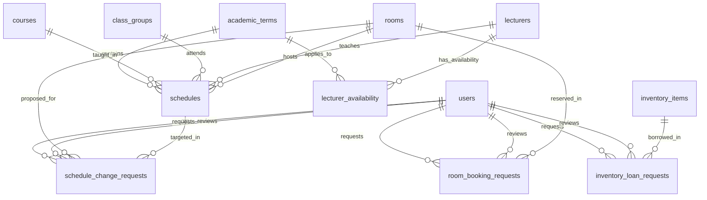

# DETAILED DATABASE DESIGN & TYPEORM ENTITY SPECIFICATION
**Proyek:** Campus Facility & Schedule Manager (FasiLink — Web Application)  
**Dokumen:** Phase 1 — Database Engineering Specification  
**Basis Data:** PostgreSQL 16  
**ORM:** TypeORM (TypeScript)  
**Status:** Final Specification for Phase 2  
**Tanggal:** 4 November 2026  

---

## 1. Prinsip & Konvensi Desain Basis Data

1. **Integritas Relasional Penuh:** Seluruh relasi antar-entitas ditegakkan di level database melalui *Foreign Key Constraints* dengan `ON DELETE RESTRICT` (atau `ON DELETE CASCADE` hanya pada data audit child yang bergantung).
2. **Kesesuaian Tipe Data Native PostgreSQL:**
   - Tanggal: `DATE` (format ISO `YYYY-MM-DD`).
   - Jam/Waktu: `TIME WITHOUT TIME ZONE` (format `HH:mm:ss`).
   - Timestamp Transaksi: `TIMESTAMP WITH TIME ZONE` (`timestamptz`).
   - Identitas Numerik: `BIGINT GENERATED ALWAYS AS IDENTITY` (atau `BIGSERIAL`) untuk mendukung skalabilitas.
   - Status & Peran: PostgreSQL Native `ENUM` atau `VARCHAR` dengan `CHECK constraint`. Untuk portabilitas TypeORM dan performa migrasi, digunakan `VARCHAR(32)` dengan check constraint eksplisit di level database dan TypeScript string enum di lapisan aplikasi.
3. **Audit Fields Universal:**
   Setiap tabel utama memiliki:
   - `created_at TIMESTAMPTZ NOT NULL DEFAULT NOW()`
   - `updated_at TIMESTAMPTZ NOT NULL DEFAULT NOW()`
   - `created_by_user_id BIGINT REFERENCES users(id)` (opsional untuk audit actor)
   - `is_active BOOLEAN NOT NULL DEFAULT TRUE` (untuk soft-deactivation)
4. **Strategi Migrasi:**
   - Penegakan larangan `synchronize: true` pada konfigurasi TypeORM lingkungan produksi dan staging.
   - Semua perubahan skema wajib menggunakan berkas migrasi berurutan (`src/database/migrations/<timestamp>-<name>.ts`).
   - Seeder otomatis disediakan untuk inisialisasi master data akademik dan user default (`src/database/seeds/`).

---

## 2. Entity-Relationship Diagram (ERD)



---

## 3. Spesifikasi Skema Tabel & Constraint PostgreSQL

### 3.1 Tabel `users`
Menyimpan kredensial dan hak akses pengguna sistem.
```sql
CREATE TABLE users (
    id BIGINT GENERATED ALWAYS AS IDENTITY PRIMARY KEY,
    full_name VARCHAR(150) NOT NULL,
    username VARCHAR(50) NOT NULL,
    password_hash VARCHAR(255) NOT NULL,
    role VARCHAR(20) NOT NULL DEFAULT 'USER',
    email VARCHAR(150),
    phone_number VARCHAR(30),
    is_active BOOLEAN NOT NULL DEFAULT TRUE,
    created_at TIMESTAMPTZ NOT NULL DEFAULT NOW(),
    updated_at TIMESTAMPTZ NOT NULL DEFAULT NOW(),
    CONSTRAINT uq_users_username UNIQUE (username),
    CONSTRAINT chk_users_role CHECK (role IN ('ADMIN', 'USER'))
);
CREATE INDEX idx_users_username ON users(username);
CREATE INDEX idx_users_role ON users(role);
```

### 3.2 Tabel Master Akademik (Sesuai ADR-011)
#### A. `academic_terms`
```sql
CREATE TABLE academic_terms (
    id BIGINT GENERATED ALWAYS AS IDENTITY PRIMARY KEY,
    term_name VARCHAR(100) NOT NULL,
    start_date DATE NOT NULL,
    end_date DATE NOT NULL,
    is_active BOOLEAN NOT NULL DEFAULT TRUE,
    created_at TIMESTAMPTZ NOT NULL DEFAULT NOW(),
    updated_at TIMESTAMPTZ NOT NULL DEFAULT NOW(),
    CONSTRAINT chk_academic_term_dates CHECK (start_date <= end_date)
);
```

#### B. `courses`
```sql
CREATE TABLE courses (
    id BIGINT GENERATED ALWAYS AS IDENTITY PRIMARY KEY,
    course_code VARCHAR(20) NOT NULL,
    course_name VARCHAR(150) NOT NULL,
    sks INTEGER NOT NULL DEFAULT 3 CHECK (sks > 0),
    is_active BOOLEAN NOT NULL DEFAULT TRUE,
    created_at TIMESTAMPTZ NOT NULL DEFAULT NOW(),
    updated_at TIMESTAMPTZ NOT NULL DEFAULT NOW(),
    CONSTRAINT uq_courses_code UNIQUE (course_code)
);
CREATE INDEX idx_courses_code ON courses(course_code);
```

#### C. `class_groups`
```sql
CREATE TABLE class_groups (
    id BIGINT GENERATED ALWAYS AS IDENTITY PRIMARY KEY,
    study_program VARCHAR(100) NOT NULL,
    cohort_year INTEGER NOT NULL CHECK (cohort_year >= 2000),
    class_code VARCHAR(50) NOT NULL,
    student_count INTEGER CHECK (student_count IS NULL OR student_count > 0),
    is_active BOOLEAN NOT NULL DEFAULT TRUE,
    created_at TIMESTAMPTZ NOT NULL DEFAULT NOW(),
    updated_at TIMESTAMPTZ NOT NULL DEFAULT NOW(),
    CONSTRAINT uq_class_groups_composite UNIQUE (study_program, cohort_year, class_code)
);
CREATE INDEX idx_class_groups_code ON class_groups(class_code);
```

#### D. `lecturers`
```sql
CREATE TABLE lecturers (
    id BIGINT GENERATED ALWAYS AS IDENTITY PRIMARY KEY,
    lecturer_code VARCHAR(30) NOT NULL,
    full_name VARCHAR(150) NOT NULL,
    email VARCHAR(150),
    phone_number VARCHAR(30),
    is_active BOOLEAN NOT NULL DEFAULT TRUE,
    created_at TIMESTAMPTZ NOT NULL DEFAULT NOW(),
    updated_at TIMESTAMPTZ NOT NULL DEFAULT NOW(),
    CONSTRAINT uq_lecturers_code UNIQUE (lecturer_code)
);
CREATE INDEX idx_lecturers_code ON lecturers(lecturer_code);
```

#### E. `lecturer_availability`
```sql
CREATE TABLE lecturer_availability (
    id BIGINT GENERATED ALWAYS AS IDENTITY PRIMARY KEY,
    lecturer_id BIGINT NOT NULL REFERENCES lecturers(id) ON DELETE RESTRICT,
    term_id BIGINT NOT NULL REFERENCES academic_terms(id) ON DELETE RESTRICT,
    day_of_week SMALLINT NOT NULL CHECK (day_of_week BETWEEN 1 AND 7),
    start_time TIME WITHOUT TIME ZONE NOT NULL,
    end_time TIME WITHOUT TIME ZONE NOT NULL,
    notes TEXT,
    created_at TIMESTAMPTZ NOT NULL DEFAULT NOW(),
    updated_at TIMESTAMPTZ NOT NULL DEFAULT NOW(),
    CONSTRAINT chk_lecturer_avail_times CHECK (start_time < end_time)
);
CREATE INDEX idx_lecturer_avail_query ON lecturer_availability(lecturer_id, term_id, day_of_week);
```

### 3.3 Tabel Fasilitas & Inventaris
#### A. `rooms`
```sql
CREATE TABLE rooms (
    id BIGINT GENERATED ALWAYS AS IDENTITY PRIMARY KEY,
    room_code VARCHAR(50) NOT NULL,
    room_name VARCHAR(100) NOT NULL,
    building VARCHAR(100) NOT NULL,
    floor SMALLINT NOT NULL,
    capacity INTEGER NOT NULL CHECK (capacity > 0),
    description TEXT,
    is_active BOOLEAN NOT NULL DEFAULT TRUE,
    created_at TIMESTAMPTZ NOT NULL DEFAULT NOW(),
    updated_at TIMESTAMPTZ NOT NULL DEFAULT NOW(),
    CONSTRAINT uq_rooms_code UNIQUE (room_code)
);
CREATE INDEX idx_rooms_code ON rooms(room_code);
CREATE INDEX idx_rooms_building ON rooms(building);
```

#### B. `inventory_items`
```sql
CREATE TABLE inventory_items (
    id BIGINT GENERATED ALWAYS AS IDENTITY PRIMARY KEY,
    item_code VARCHAR(50) NOT NULL,
    item_name VARCHAR(150) NOT NULL,
    description TEXT,
    total_quantity INTEGER NOT NULL CHECK (total_quantity >= 0),
    condition_notes TEXT,
    is_active BOOLEAN NOT NULL DEFAULT TRUE,
    created_at TIMESTAMPTZ NOT NULL DEFAULT NOW(),
    updated_at TIMESTAMPTZ NOT NULL DEFAULT NOW(),
    CONSTRAINT uq_inventory_items_code UNIQUE (item_code)
);
CREATE INDEX idx_inventory_items_code ON inventory_items(item_code);
```

### 3.4 Tabel Transaksional & Penjadwalan
#### A. `schedules` (Jadwal Kuliah Mingguan Resmi)
```sql
CREATE TABLE schedules (
    id BIGINT GENERATED ALWAYS AS IDENTITY PRIMARY KEY,
    term_id BIGINT NOT NULL REFERENCES academic_terms(id) ON DELETE RESTRICT,
    course_id BIGINT NOT NULL REFERENCES courses(id) ON DELETE RESTRICT,
    class_group_id BIGINT NOT NULL REFERENCES class_groups(id) ON DELETE RESTRICT,
    lecturer_id BIGINT NOT NULL REFERENCES lecturers(id) ON DELETE RESTRICT,
    room_id BIGINT NOT NULL REFERENCES rooms(id) ON DELETE RESTRICT,
    day_of_week SMALLINT NOT NULL CHECK (day_of_week BETWEEN 1 AND 7),
    start_time TIME WITHOUT TIME ZONE NOT NULL,
    end_time TIME WITHOUT TIME ZONE NOT NULL,
    is_active BOOLEAN NOT NULL DEFAULT TRUE,
    created_at TIMESTAMPTZ NOT NULL DEFAULT NOW(),
    updated_at TIMESTAMPTZ NOT NULL DEFAULT NOW(),
    CONSTRAINT chk_schedules_time_order CHECK (start_time < end_time)
);
CREATE INDEX idx_schedules_term_day_room ON schedules(term_id, day_of_week, room_id) WHERE is_active = TRUE;
CREATE INDEX idx_schedules_term_day_lecturer ON schedules(term_id, day_of_week, lecturer_id) WHERE is_active = TRUE;
CREATE INDEX idx_schedules_term_day_class ON schedules(term_id, day_of_week, class_group_id) WHERE is_active = TRUE;
```

#### B. `room_booking_requests` (Pengajuan Peminjaman Ruangan)
```sql
CREATE TABLE room_booking_requests (
    id BIGINT GENERATED ALWAYS AS IDENTITY PRIMARY KEY,
    requester_user_id BIGINT NOT NULL REFERENCES users(id) ON DELETE RESTRICT,
    room_id BIGINT NOT NULL REFERENCES rooms(id) ON DELETE RESTRICT,
    booking_date DATE NOT NULL,
    start_time TIME WITHOUT TIME ZONE NOT NULL,
    end_time TIME WITHOUT TIME ZONE NOT NULL,
    expected_attendees INTEGER NOT NULL CHECK (expected_attendees > 0),
    purpose TEXT NOT NULL,
    status VARCHAR(30) NOT NULL DEFAULT 'PENDING',
    reviewed_by_user_id BIGINT REFERENCES users(id) ON DELETE SET NULL,
    reviewed_at TIMESTAMPTZ,
    rejection_reason TEXT,
    created_at TIMESTAMPTZ NOT NULL DEFAULT NOW(),
    updated_at TIMESTAMPTZ NOT NULL DEFAULT NOW(),
    CONSTRAINT chk_room_booking_status CHECK (status IN ('PENDING', 'APPROVED', 'REJECTED', 'CANCELLED')),
    CONSTRAINT chk_room_booking_time_order CHECK (start_time < end_time)
);
CREATE INDEX idx_room_booking_room_date ON room_booking_requests(room_id, booking_date, status);
CREATE INDEX idx_room_booking_requester ON room_booking_requests(requester_user_id);
```

#### C. `inventory_loan_requests` (Pengajuan Peminjaman Barang)
```sql
CREATE TABLE inventory_loan_requests (
    id BIGINT GENERATED ALWAYS AS IDENTITY PRIMARY KEY,
    requester_user_id BIGINT NOT NULL REFERENCES users(id) ON DELETE RESTRICT,
    item_id BIGINT NOT NULL REFERENCES inventory_items(id) ON DELETE RESTRICT,
    quantity INTEGER NOT NULL CHECK (quantity > 0),
    loan_date DATE NOT NULL,
    expected_return_date DATE NOT NULL,
    purpose TEXT NOT NULL,
    status VARCHAR(30) NOT NULL DEFAULT 'PENDING',
    reviewed_by_user_id BIGINT REFERENCES users(id) ON DELETE SET NULL,
    reviewed_at TIMESTAMPTZ,
    rejection_reason TEXT,
    handed_over_at TIMESTAMPTZ,
    returned_at TIMESTAMPTZ,
    return_condition_notes TEXT,
    created_at TIMESTAMPTZ NOT NULL DEFAULT NOW(),
    updated_at TIMESTAMPTZ NOT NULL DEFAULT NOW(),
    CONSTRAINT chk_inventory_loan_status CHECK (status IN ('PENDING', 'APPROVED', 'REJECTED', 'CANCELLED', 'HANDED_OVER', 'RETURNED')),
    CONSTRAINT chk_inventory_loan_dates CHECK (loan_date <= expected_return_date)
);
CREATE INDEX idx_inventory_loan_item_status ON inventory_loan_requests(item_id, status);
CREATE INDEX idx_inventory_loan_requester ON inventory_loan_requests(requester_user_id);
```

#### D. `schedule_change_requests` (Sesuai ADR-010)
Dilengkapi `effective_date` dan `previous_schedule_snapshot` JSONB untuk mencatat kondisi asli saat disetujui, melindungi historis masa lalu dari efek retroaktif.
```sql
CREATE TABLE schedule_change_requests (
    id BIGINT GENERATED ALWAYS AS IDENTITY PRIMARY KEY,
    requester_user_id BIGINT NOT NULL REFERENCES users(id) ON DELETE RESTRICT,
    schedule_id BIGINT NOT NULL REFERENCES schedules(id) ON DELETE RESTRICT,
    proposed_day_of_week SMALLINT NOT NULL CHECK (proposed_day_of_week BETWEEN 1 AND 7),
    proposed_start_time TIME WITHOUT TIME ZONE NOT NULL,
    proposed_end_time TIME WITHOUT TIME ZONE NOT NULL,
    proposed_room_id BIGINT NOT NULL REFERENCES rooms(id) ON DELETE RESTRICT,
    reason TEXT NOT NULL,
    effective_date DATE,
    previous_schedule_snapshot JSONB,
    status VARCHAR(30) NOT NULL DEFAULT 'PENDING',
    reviewed_by_user_id BIGINT REFERENCES users(id) ON DELETE SET NULL,
    reviewed_at TIMESTAMPTZ,
    rejection_reason TEXT,
    created_at TIMESTAMPTZ NOT NULL DEFAULT NOW(),
    updated_at TIMESTAMPTZ NOT NULL DEFAULT NOW(),
    CONSTRAINT chk_schedule_change_status CHECK (status IN ('PENDING', 'APPROVED', 'REJECTED', 'CANCELLED')),
    CONSTRAINT chk_schedule_change_time_order CHECK (proposed_start_time < proposed_end_time)
);
CREATE INDEX idx_schedule_change_schedule ON schedule_change_requests(schedule_id);
CREATE INDEX idx_schedule_change_requester ON schedule_change_requests(requester_user_id);
```

---

## 4. Pola Transaksi & Penanganan Konkurensi (Anti-Race Condition)

### 4.1 Approval Peminjaman Ruangan
Pada saat Admin menekan tombol Approve:
```sql
BEGIN TRANSACTION ISOLATION LEVEL READ COMMITTED;

-- 1. Lock baris request peminjaman
SELECT * FROM room_booking_requests WHERE id = $requestId FOR UPDATE;

-- 2. Cek apakah status masih PENDING
-- Jika bukan PENDING, rollback dan lemparkan HTTP 400 Bad Request

-- 3. Lock dan re-validasi ketersediaan ruangan
-- Periksa jadwal kuliah aktif:
SELECT COUNT(*) FROM schedules 
WHERE room_id = $roomId 
  AND day_of_week = EXTRACT(ISODOW FROM $bookingDate)
  AND is_active = TRUE
  AND $startTime < end_time AND $endTime > start_time;

-- Periksa peminjaman ruangan lain yang telah APPROVED:
SELECT COUNT(*) FROM room_booking_requests
WHERE room_id = $roomId 
  AND booking_date = $bookingDate
  AND status = 'APPROVED'
  AND id != $requestId
  AND $startTime < end_time AND $endTime > start_time;

-- 4. Jika ada bentrok, rollback dan lemparkan HTTP 409 Conflict

-- 5. Jika aman, update status:
UPDATE room_booking_requests 
SET status = 'APPROVED', 
    reviewed_by_user_id = $adminId, 
    reviewed_at = NOW(), 
    updated_at = NOW()
WHERE id = $requestId;

COMMIT;
```

### 4.2 Approval Peminjaman Barang & Sirkulasi Stok
```sql
BEGIN TRANSACTION ISOLATION LEVEL READ COMMITTED;

-- 1. Lock item inventaris untuk serialisasi stok
SELECT total_quantity FROM inventory_items WHERE id = $itemId FOR UPDATE;

-- 2. Hitung stok yang sedang terpesan
SELECT COALESCE(SUM(quantity), 0) AS reserved_quantity 
FROM inventory_loan_requests 
WHERE item_id = $itemId AND status IN ('APPROVED', 'HANDED_OVER');

-- 3. Cek ketersediaan:
-- IF (total_quantity - reserved_quantity) < requested_quantity THEN ROLLBACK with 409 Conflict;

-- 4. Update status loan
UPDATE inventory_loan_requests 
SET status = 'APPROVED', 
    reviewed_by_user_id = $adminId, 
    reviewed_at = NOW(), 
    updated_at = NOW()
WHERE id = $loanId;

COMMIT;
```

### 4.3 Mutasi Jadwal Resmi Atomik (ADR-010)
```sql
BEGIN TRANSACTION ISOLATION LEVEL SERIALIZABLE;

-- 1. Ambil data usulan dan jadwal asli
SELECT * FROM schedule_change_requests WHERE id = $changeRequestId FOR UPDATE;
SELECT * FROM schedules WHERE id = $scheduleId FOR UPDATE;

-- 2. Validasi bentrok jadwal komprehensif pada slot baru (kecualikan scheduleId asli)
-- Cek bentrok ruangan, dosen, dan rombel kelas...

-- 3. Simpan snapshot kondisi jadwal asli sebelum dimutasi ke JSONB
UPDATE schedule_change_requests 
SET status = 'APPROVED',
    reviewed_by_user_id = $adminId,
    reviewed_at = NOW(),
    effective_date = CURRENT_DATE,
    previous_schedule_snapshot = jsonb_build_object(
        'day_of_week', $origDay,
        'start_time', $origStart,
        'end_time', $origEnd,
        'room_id', $origRoomId
    ),
    updated_at = NOW()
WHERE id = $changeRequestId;

-- 4. Mutasi jadwal resmi
UPDATE schedules 
SET day_of_week = $newDay,
    start_time = $newStart,
    end_time = $newEnd,
    room_id = $newRoomId,
    updated_at = NOW()
WHERE id = $scheduleId;

COMMIT;
```

---

## 5. Struktur Folder Entity TypeORM (NestJS)

Pada Phase 2, entitas akan ditempatkan di direktori backend:
```text
fasilink-web/backend/src/
├── database/
│   ├── entities/
│   │   ├── user.entity.ts
│   │   ├── academic-term.entity.ts
│   │   ├── course.entity.ts
│   │   ├── class-group.entity.ts
│   │   ├── lecturer.entity.ts
│   │   ├── lecturer-availability.entity.ts
│   │   ├── room.entity.ts
│   │   ├── inventory-item.entity.ts
│   │   ├── schedule.entity.ts
│   │   ├── room-booking-request.entity.ts
│   │   ├── inventory-loan-request.entity.ts
│   │   └── schedule-change-request.entity.ts
│   ├── migrations/
│   └── seeds/
```
Semua file entity menerapkan decorator `@Entity()`, `@PrimaryGeneratedColumn('identity')`, `@Column()`, `@ManyToOne()`, `@OneToMany()`, `@CreateDateColumn()`, dan `@UpdateDateColumn()`.

